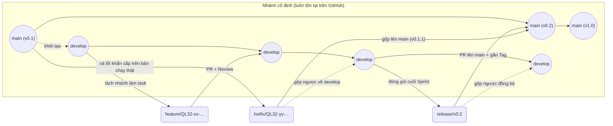

# Quy ước phân nhánh GitHub theo mô hình GitFlow — Đề tài QL32-W

Phục vụ làm việc nhóm kỹ thuật (FE / BE / FULL) và minh chứng **Quản trị cấu hình** của học phần MAN104 (Mục 5 & Mục 6 đề bài).

**Nguồn tham khảo mô hình GitFlow:**
- Vincent Driessen — *A successful Git branching model*: https://nvie.com/posts/a-successful-git-branching-model/
- Atlassian Git Tutorial — *Gitflow Workflow*: https://www.atlassian.com/git/tutorials/comparing-workflows/gitflow-workflow

*(Áp dụng của nhóm: gắn mã công việc Jira của dự án `QL32-W` vào tên nhánh/commit và ánh xạ các mốc tag phát hành `v0.1` / `v0.2` / `v1.0` theo yêu cầu đề bài MAN104).*

---

## 1. Sơ đồ luồng 5 loại nhánh (đúng theo chuẩn GitFlow)



---

## 2. Ý nghĩa & Quy tắc của từng nhánh

### 2.1 Hai nhánh cố định (tạo sẵn trên GitHub)

| Nhánh | Màu trong sơ đồ | Vai trò | Quy tắc bắt buộc |
|---|---|---|---|
| **`main`** | Xanh dương | Chứa mã nguồn **ổn định, chạy thật** (tự động hoặc chủ động deploy lên **Render** phục vụ Sprint Review, UAT và Bảo vệ). Mỗi mốc phát hành trên `main` được gắn **Tag phiên bản** (`v0.1`, `v0.2`, `v1.0`). | **Cấm push code trực tiếp.** Chỉ nhận Pull Request (PR) từ nhánh `release/*` hoặc `hotfix/*` sau khi đã kiểm thử chạy được. |
| **`develop`** | Xanh lá | Nhánh **tích hợp chung hàng ngày** của cả nhóm (FE + BE + FULL). Mọi tính năng mới sau khi làm xong đều gộp về đây để ghép nối. | **Hạn chế push trực tiếp khi đã vào Sprint code.** Nhận PR từ các nhánh `feature/*` có ít nhất 1 thành viên khác review. |

### 2.2 Ba loại nhánh tạm thời (chỉ tạo khi phát sinh việc, gộp xong thì đóng)

| Loại nhánh | Màu trong sơ đồ | Tách ra từ đâu? | Gộp (Merge PR) về đâu? | Khi nào tạo & Quy ước đặt tên |
|---|---|---|---|---|
| **`feature/*`** | Cam / Vàng | `develop` | `develop` | Tạo khi thành viên bắt đầu code 1 User Story / Task trên Jira.<br>Cú pháp: `feature/<MA-JIRA>-<mo-ta-ngan>`<br>Ví dụ: `feature/QL32-05-crud-ma-hang`, `feature/QL32-12-ui-nhap-san-luong` |
| **`release/*`** | Tím | `develop` | **`main`** (kèm gắn Tag) **VÀ** gộp ngược lại **`develop`** | Tạo vào cuối mỗi Sprint khi tính năng Sprint đó trên `develop` đã đủ để đóng băng, chỉ còn test E2E / sửa lỗi nhỏ và chuẩn bị demo.<br>Cú pháp: `release/v0.1`, `release/v0.2`, `release/v1.0` |
| **`hotfix/*`** | Đỏ | `main` | **`main`** (tăng bản vá nhỏ như `v0.1.1`) **VÀ** gộp ngược lại **`develop`** | Chỉ tạo khi bản đang chạy công khai trên **Render** (`main`) phát sinh lỗi nghiêm trọng lúc giảng viên chấm / xưởng đang UAT mà `develop` đang có code dở chưa đẩy lên được.<br>Cú pháp: `hotfix/<MA-JIRA>-<loi-khan>` (VD: `hotfix/QL32-45-loi-timeout-chatbot`) |

> **Lưu ý quan trọng:** Không tạo nhánh tên cụt ngủn là `feature`, `release`, `hotfix` để trống trên GitHub. Ba loại này luôn có hậu tố tên việc/phiên bản đi kèm (`feature/...`, `release/...`, `hotfix/...`) và chỉ sinh ra đúng lúc làm việc đó.

---

## 3. Lộ trình gắn Tag phiên bản trên nhánh `main` (khớp đề MAN104)

| Mốc thời gian | Nhánh chuẩn bị | Gộp vào `main` & Gắn Tag | Nội dung bàn giao chính |
|---|---|---|---|
| **Cuối Sprint 1 (Tuần 3)** | `release/v0.1` | Tag **`v0.1`** | E1–E3: Auth/RBAC, Danh mục Mã hàng & Đơn hàng, Kế hoạch chuyền |
| **Cuối Sprint 2 (Tuần 5)** | `release/v0.2` | Tag **`v0.2`** | E4–E7: Sản lượng giờ & cuối ca, Cảnh báo, Báo cáo NS, Chatbot Q&A cơ bản *(phục vụ báo cáo giữa kỳ ≥ 50%)* |
| **Cuối Sprint 3 / Phát hành (Tuần 7–8)** | `release/v1.0` | Tag **`v1.0`** | E8–E10 + UAT: Dashboard TV Kiosk, Lương khoán, Chatbot Tool Calling, hoàn thiện sau UAT để bảo vệ |

---

## 4. Quy tắc Commit & Pull Request hàng ngày của nhóm

1. **Cú pháp Commit (bắt buộc có mã Jira để khớp tiêu chí chấm Mục 5 đề bài):**
   ```text
   <MA-JIRA>: <mô tả ngắn gọn việc đã làm>
   ```
   - Ví dụ đúng: `QL32-08: them API khoa ban ghi san luong sau khi chot`
   - Ví dụ sai (tránh dùng): `update code`, `fix bug`, `asdf`
2. **Luồng thao tác chuẩn của 1 thành viên khi nhận task mới:**
   ```bash
   # Bước 1: Luôn kéo bản mới nhất của develop về máy
   git checkout develop
   git pull origin develop

   # Bước 2: Tách nhánh feature mới cho task của mình
   git checkout -b feature/QL32-08-khoa-san-luong

   # Bước 3: Code xong -> kiểm tra không dính file rác hay .env
   git status
   git add <cac-file-code-vua-sua>
   git commit -m "QL32-08: them API khoa ban ghi san luong sau khi chot"

   # Bước 4: Đẩy nhánh feature lên GitHub rồi mở Pull Request vào nhánh develop
   git push -u origin feature/QL32-08-khoa-san-luong
   ```
3. **Đảm bảo đóng góp đồng đều:** Mọi thành viên tham gia phát triển hoặc cập nhật tài liệu đặc tả/kiểm thử đều commit bằng tài khoản GitHub cá nhân của mình qua PR để lịch sử `Insights → Contributors` ghi nhận minh bạch.
